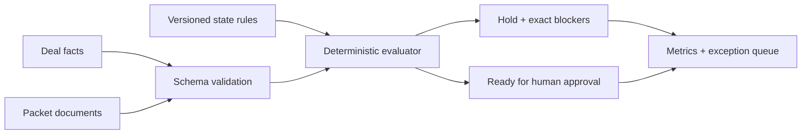

# Architecture

The static Pages build imports `data/demo.json` and performs the same documented calculation client-side. `api/main.py` is the deployable backend boundary and is tested, but is not hosted.

## Contract

`POST /packet-audit` accepts `deal_id`, `state` (FL/GA/NC) and 1–12 known document identifiers. It returns readiness, missing items, status, bank hold and estimated clearance only for a complete packet.

## Shadow paths

- Invalid ID/state/empty documents → FastAPI 422.
- Unknown deal → 404 `Deal not found`.
- Duplicate or unknown document identifiers → named 422 detail.
- Expired rule (future) → fail closed and route to rules review.
- OCR below confidence floor (future) → document remains unverified.
- Portal timeout (future) → no resubmission without checking idempotency key.

## Security and observability

Production: encrypted storage, malware scanning, tenant-scoped authorization, secrets manager, redacted logs, retention controls and immutable audit history. Metrics cover rule age, audit duration, first-pass acceptance, overrides, rejection reasons and portal errors.
